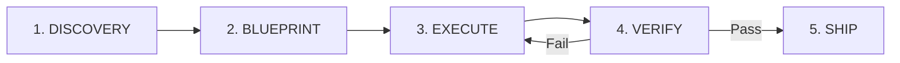

# GSD Core — Milestone-Driven Execution Runbook

Use this runbook to execute complex engineering tasks with zero drift, tight context budgets, and deterministic delivery.

---

## The GSD Execution Cycle



### Phase 1: DISCOVERY (Input & Ground Truth)
- **Identify Target Surface Area**:
  - Run directory or file searches to locate all relevant source files.
  - Read existing interfaces, entities, and controllers before modifying anything.
- **Check Invariants**:
  - Coffee domain: Mass balance (~5:1 cherry:green), unbroken traceability chains, transit manifests (<0.5% road loss), audit trail.
  - Engineering rules: Next.js 15 App Router, React 19, Refine v5, Ant Design 5 token styling, C# 13 / .NET 9.
- **Formulate Problem Statement**: Summarize the exact gap between current code and expected behavior.

### Phase 2: BLUEPRINT (Architecture & Budgeting)
- **File Impact Matrix**:
  | File Path | Operation (Create / Edit / Delete) | Projected Line Count (<250 lines) | Purpose |
  |---|---|---|---|
- **Interface & DTO Contracts**:
  - Declare exact TypeScript types or C# records before implementation.
  - Validate that zero `any` and zero unchecked `as` type casts are introduced.
- **Checkpoint Criteria**:
  - What exact commands will prove this works? (e.g., `dotnet test ...`, `npm run lint`).

### Phase 3: EXECUTE (Surgical Implementation)
- **Step 1: Subtract**: Remove dead, obsolete, or duplicate code first.
- **Step 2: Core Logic**: Implement backend models, handlers, or domain logic.
- **Step 3: Frontend Components**: Implement UI components following Ant Design 5 tokens and keeping components under 250 lines.
- **Step 4: Integration**: Connect UI to backend endpoints with typed contracts.

### Phase 4: VERIFY (Automated Proof)
- Run the Ralph Loop verification commands:
  ```powershell
  dotnet build backend/AloCoffee.Backend.csproj
  dotnet test tests/AloCoffee.Backend.Tests/AloCoffee.Backend.Tests.csproj
  cd frontend; npm run lint
  npx tsc --noEmit
  ```
- **Automated Docker Sync**: Rebuild and deploy containers:
  ```powershell
  docker compose build
  docker compose up -d
  docker compose ps
  ```
- If any check fails, do NOT declare success or ask the user to test. Jump back to EXECUTE to resolve the failure.

### Phase 5: SHIP (Delivery Summary)
- Provide a structured deliverable summary:
  1. Files modified/created with clickable links (`file:///...`).
  2. Proof of verification (compilation, test results, and Docker container status).
  3. Live application URLs (`http://localhost:3030` frontend, `http://localhost:5050` backend).
