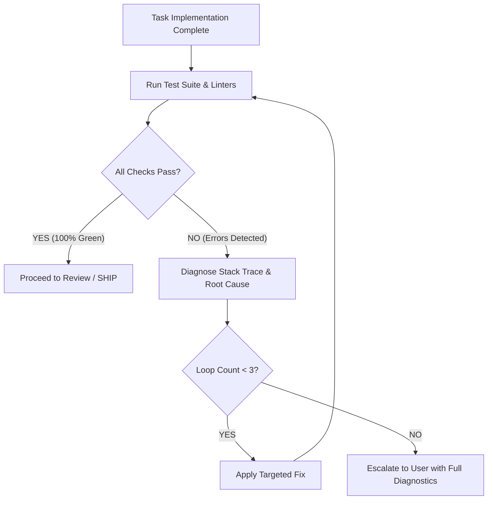

# Ralph Loop — Autonomous Verification & Self-Correction Runbook

The **Ralph Loop** ensures that code is never left in a broken or untested state.

---

## 1. The Execution Loop



---

## 2. Standard Command Suite for ALO Coffee ERP

Execute the relevant checks based on modified components:

### Backend Checks
```powershell
# Build verification
dotnet build backend/AloCoffee.Backend.csproj

# Unit & domain test suite
dotnet test tests/AloCoffee.Backend.Tests/AloCoffee.Backend.Tests.csproj
```

### Frontend Checks
```powershell
# Next.js & ESLint verification
cd frontend; npm run lint
npx tsc --noEmit
```

### Automated Docker Rebuild & Update (Mandatory after code changes)
```powershell
# 1. Rebuild updated images
docker compose build

# 2. Deploy refreshed containers
docker compose up -d

# 3. Verify container health & logs
docker compose ps
docker compose logs backend --tail=30
docker compose logs frontend --tail=30
```

---

## 3. Self-Healing Decision Tree

1. **Compilation Error (C# or TypeScript)**:
   - Check missing using/imports, interface mismatches, or type regressions.
   - Do NOT cast with `as any` or suppress with `@ts-ignore` / `#pragma warning disable`.
   - Fix the underlying type signature or entity mapping.
2. **Test Assertion Failure**:
   - Inspect expected vs actual values.
   - Trace back to domain invariant: Did cherry yield violate ~5:1? Did transit variance exceed 0.50%?
   - Correct the business rule or test fixture data accordingly.
3. **Database Migration / Schema Drift**:
   - Check entity configurations in `AloCoffeeDbContext.cs`.
   - Ensure PostgreSQL column names and data types match C# model properties.
