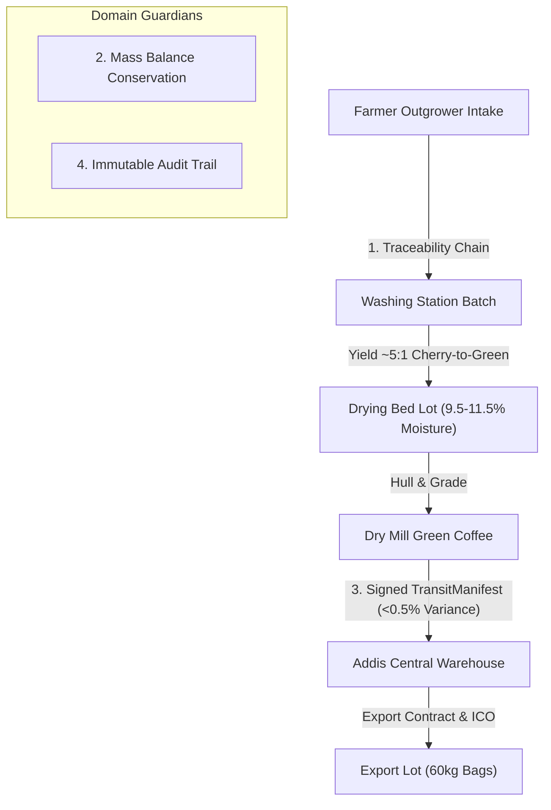

# ALO Coffee Domain Invariants & Modeling (pstack Edition)

Encode the real coffee domain in explicit structures and invariants instead of scattering rules across ad-hoc conditionals.

---

## 1. The Four Non-Negotiable Invariants

Every backend endpoint and frontend view dealing with coffee lots must strictly uphold these four domain invariants:



---

## 2. Invariant Specifications

### Invariant 1: Mass Balance Conservation
- **Cherry to Green Ratio**: Standard dry/washed processing requires approximately 5 kg of fresh cherry to produce 1 kg of export-grade green coffee (expected green yield band: 18% - 22%).
- **Moisture Band**: Parchment on drying beds must achieve between **9.5% and 11.5%** moisture content before bagging or milling.
  - `< 9.5%`: Over-dried coffee (damage to cellular structure and cup profile).
  - `> 11.5%`: Risk of mold, mycotoxins, and spoilage during storage/transit.
- **Rule in Code**:
  ```csharp
  public static bool IsMoistureWithinExportStandard(decimal moisturePercentage) =>
      moisturePercentage is >= 9.5m and <= 11.5m;

  public static decimal CalculateGreenYieldRatio(decimal cherryWeightKg, decimal greenWeightKg) =>
      cherryWeightKg > 0 ? (greenWeightKg / cherryWeightKg) * 100m : 0m;
  ```

### Invariant 2: Unbroken Traceability Chain
- Every lot created at any facility must maintain an explicit parent lineage reference.
- Trace chain:
  `FarmerId` → `CherryBatchId` → `DryingLotId` → `DryMillLotId` → `ExportLotId`.
- No lot may be created or processed if its parent reference is missing or invalid.
- Merging multiple lots (e.g. creating an export blend) requires recording every component lot and its contributing weight.

### Invariant 3: Multi-Facility Ledger & Dual Custody
- Stock cannot move between facilities (e.g., Alo Station → Hawassa Transit Hub → Addis Ababa Mill) without an active, signed `TransitManifest`.
- **Transit Variance Threshold**: Maximum allowable transit weight loss due to handling/evaporation is **0.50%**.
- If `(DispatchWeight - ReceivingWeight) / DispatchWeight > 0.005`, the receiving facility must flag the shipment as `DISCREPANCY_FLAGGED` and halt final intake confirmation pending supervisor audit.

### Invariant 4: Immutable Audit Trail
- Every lot state mutation, stock movement, or cupping evaluation must persist:
  - `actor_id`: User or system agent executing the action.
  - `timestamp`: UTC timestamp.
  - `previous_state` & `new_state`: Exact snapshot of modified fields.
- Hard deletions on inventory records or audit logs are forbidden. Soft deletions or offsetting journal entries must be used.

---

## 3. Frontend Invariant Verification

When building frontend views:
1. Display warning indicators when drying bed moisture is outside 9.5% - 11.5%.
2. Block lot dispatch or milling transitions in the UI if required fields (moisture, weight, bag count) are missing.
3. Automatically compute and display transit variance upon receiving shipment entry.
