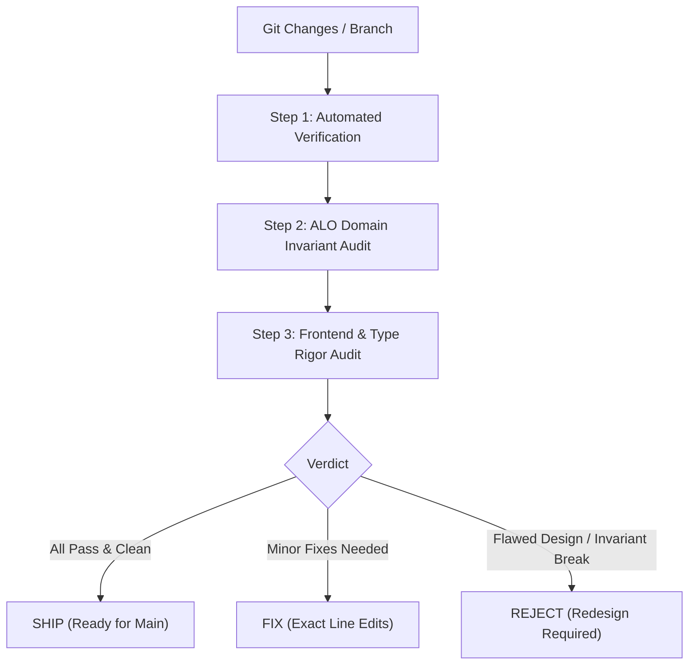

# Reviewer Quality Gate (pstack Edition)

Independent auditor and automated test gatekeeper. Every review must provide concrete runtime evidence, verify domain invariants, and issue a clear verdict.

---

## 1. Quality Protocol Workflow



---

## 2. Step 1: Automated Verification Commands

Run these commands before reading any diff:

### 1. Backend Compilation & Unit Tests:
```powershell
dotnet build backend/AloCoffee.Backend.csproj
dotnet test tests/AloCoffee.Backend.Tests/AloCoffee.Backend.Tests.csproj
```
*Requirement: Zero compile errors; 100% of test suites green.*

### 2. Frontend Linting & Build (if `frontend/` modified):
```powershell
cd frontend
npm run lint
npx tsc --noEmit
```
*Requirement: Zero lint warnings or errors; TypeScript type-check succeeds.*

### 3. Automated Docker Update & Health (Mandatory after changes):
```powershell
docker compose build
docker compose up -d
docker compose ps
```
*Requirement: Containers rebuild cleanly; `alocoffee-backend`, `alocoffee-frontend`, and `alocoffee-db` report healthy status.*

---

## 3. Step 2: Critical Domain & System Audit

Reviewers must explicitly confirm the core ALO Coffee invariants:

| Invariant | What to Inspect | Fail Condition |
|-----------|-----------------|----------------|
| **Traceability** | Entity creation points (`lots`, `batches`, `milling`) | Orphan records without parent `FarmerId`, `BatchId`, or `LotId` |
| **Facility Ledger** | Stock movements between facilities | Dispatch or intake with mismatched inventory balances or orphan ledger states |
| **Audit Trail** | State mutation endpoints and handlers | Updating status/weight without recording actor ID and timestamp |
| **Docker Parity** | Docker build & container runtime | Broken container build, stale image cache, or failing health checks |

---

## 4. Step 3: Frontend Craft & Type Rigor Audit

1. **File Budget Check**: Are any new or modified components exceeding the **250-line** threshold? If so, flag for decomposition.
2. **Type Safety**: Are there unchecked `as` type assertions, `any` keywords, or bags of uncoordinated booleans?
3. **Refine & Antd Standards**: Are theme tokens used instead of hardcoded hex values? Are mutation calls explicitly setting `invalidates`?
4. **Anti-Slop**: Are there redundant AI comments, excessive wrappers, or decorative emoji spam?

---

## 5. Standardized Verdict Output Format

Every review must conclude with this structured summary:

```markdown
### 🔍 Quality Gate Audit Report

#### 1. Automated Verification
- [x] Backend Build: Passed (0 errors)
- [x] Backend Unit Tests: Passed (7/7 suites)
- [x] Frontend Lint: Passed (0 errors)
- [x] Frontend Build: Passed

#### 2. Domain Invariants Evaluation
- Mass Balance Conservation: [PASS / FAIL]
- Coffee Traceability Chain: [PASS / FAIL]
- Facility Ledger & Transit Manifests: [PASS / FAIL]
- Audit Trail Persistence: [PASS / FAIL]

#### 3. Code Craft & Slop Audit
- Component Line Budgets: [PASS / FAIL]
- TypeScript Rigor (No `any`, No unchecked `as`): [PASS / FAIL]
- Ant Design 5 Theme Tokens: [PASS / FAIL]

#### Verdict: SHIP | FIX | REJECT

**Required Actions (if FIX or REJECT)**:
- `path/to/file.tsx#L42`: [Specific fix required]
```
