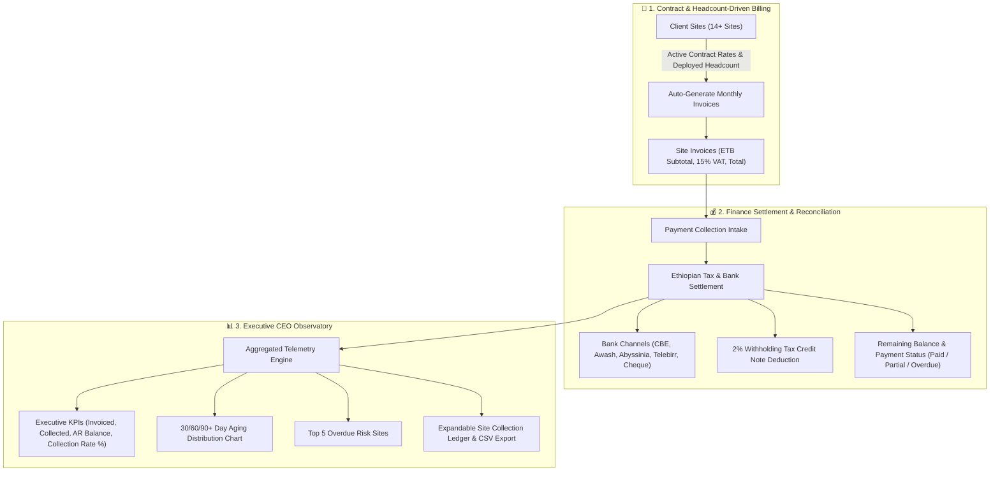

# Specification: Client Site Invoicing, Multi-Bank Payment Collection & Executive CEO Collections Observatory

**Date:** 2026-11-21  
**Origin:** GSD Explore Session — Finance Site Payment Collection & Executive CEO Reporting  
**Status:** Crystallized into Phase 19  

---

## 1. Architectural Context & Problem Statement

HAB Business PLC deploys security guards and custodial cleaning personnel across 14+ major commercial client facilities in Addis Ababa (e.g., CBE Tower, Ethiopian Airlines Cargo Terminal, Hyatt Regency, St. Paul's Hospital, Bole Medhanialem, CMC Plaza).

Currently:
1. **Finance Module**: Features payroll disbursements and operational expenses, but client billing and accounts receivable (AR) are static placeholders with no interactive ledger to manage client invoices or log collections.
2. **Executive CEO Dashboard**: Shows high-level revenue figures (ETB 8M) without operational visibility into site-level collection health, overdue aging, defaulting client risk, or division collection performance (Security vs. Cleaning).

---

## 2. Core Architecture & Workflow Decisions

### A. Billing Origin & Invoicing Engine
- Invoices are automatically generated on a monthly billing cycle for each active client site based on:
  - Base monthly contract rate or deployed headcount pricing ($N$ guards $\times$ guard rate + $M$ cleaners $\times$ cleaner rate).
  - Standard Ethiopian VAT (15%) applied to gross service charges.
  - Due date calculation (standard Net 30 days from billing date).

### B. Finance Payment Collection & Reconciliation
- **Payment Logging Modal/Drawer**: Allows Finance officers to record payments against any site invoice.
- **Multi-Bank Channels**: Commercial Bank of Ethiopia (CBE), Awash Bank, Bank of Abyssinia, Telebirr, or physical Cheque with transaction slip / receipt number.
- **Ethiopian Tax Deductions**:
  - 2% Withholding Tax: Automatically calculated and credited upon receipt of client Withholding Tax Certificate.
  - Auto-updates invoice status: `Paid` (full settlement), `Partially Paid` (partial settlement with remaining balance), `Pending / Overdue` (unsettled past due date).
- **Accounts Receivable Ledger**: Searchable, filterable by client site, payment status, division (Security vs. Cleaning), and date range.

### C. Aggregated CEO Collections Observatory
- **Executive Summary Widget directly on CEO Dashboard**:
  - Headline metrics: Total Invoiced (ETB), Total Collected (ETB), Outstanding AR (ETB), Collection Efficiency Rate (%).
  - Visual 30 / 60 / 90 / 90+ day aging distribution bar.
  - Top 5 overdue risk sites highlighting high-exposure clients exceeding 60+ days overdue.
- **Deep-Dive Collections Modal / Drawer**:
  - Full site-by-site collection breakdown with aging classification.
  - Division collection comparison (Security Services vs. Cleaning Services).
  - 1-click CSV/Print export for executive briefings and board meetings.
